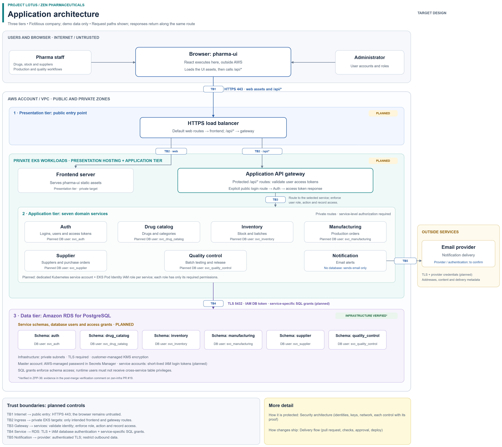

# Project Lotus: Zen Pharma DevSecOps Platform

**Building a pharmaceutical platform on AWS with Terraform, EKS, and GitHub Actions, using OIDC authentication, approval gates, and documented security testing.**

Zen Pharmaceuticals is a fictional company. Project Lotus rebuilds its platform (eight backend services and a web UI) using documented DevSecOps practices: Scrum in Jira, architecture decision records, reviewed pull requests, and evidence attached to every ticket.

> **Status (November 2026):** Sprint 3. Built and verified: Terraform state, CI identity, the approval-gated pipeline, the shared container registry, the EKS cluster and RDS PostgreSQL. In progress: pod identity. Planned: application CI, GitOps and policy as code. The application repositories stay private until go-live.

---

## Architecture

Three tiers: the web app (pharma-ui) runs in the browser; the API gateway and seven domain services run on private EKS; PostgreSQL runs on Amazon RDS, with its own schema and database user for each service that stores data. The data tier's infrastructure is built and verified; tiers marked *planned* are not deployed yet.

More detail:

- [Security architecture](docs/architecture/security-architecture.png): identities, keys, network tiers and trust boundaries, with each verified control
- [Delivery flow](docs/architecture/delivery-flow.png): how a change reaches AWS (pull request, checks, approval, apply)
- Editable sources: [`docs/architecture/`](docs/architecture/) (draw.io)

## Repositories

| Repository | Owns | Status | Visibility |
|---|---|---|---|
| [zen-infra](https://github.com/abdurahim50/zen-infra) | Terraform: state, CI identity, network, registry, EKS, RDS; the approval-gated pipeline | Foundation, EKS and RDS verified | Public |
| zen-gitops | Kubernetes manifests and policies, deployed by Argo CD | Planned | Private until go-live |
| zen-pharma-backend | Eight services; CI to build, scan, sign and push images | Image push identity verified; CI planned | Private until go-live |
| zen-pharma-frontend | Web UI; same CI pattern | Image push identity configured; CI planned | Private until go-live |

## Security controls, with proof

Each claim says exactly what was tested; the link goes to the published result.

| Control | What was tested | Evidence |
|---|---|---|
| No static AWS credentials in CI | Every workflow that needs AWS access assumes a role through GitHub OIDC, trusted by immutable repository IDs | [ADR-002](https://github.com/abdurahim50/zen-infra/blob/main/docs/adr/0002-github-oidc.md), [PR #10](https://github.com/abdurahim50/zen-infra/pull/10) |
| Infrastructure changes need human approval | Pull requests plan with a read-only role; after merge, apply waits for a reviewer in the `dev` environment; an unneeded deploy was rejected at the gate | [PR #10](https://github.com/abdurahim50/zen-infra/pull/10), [PR #12 verification](https://github.com/abdurahim50/zen-infra/pull/12#issuecomment-6723055478) |
| The pipeline cannot raise its own privileges or make itself cluster admin | IAM policy simulation: escalation attempts return `explicitDeny` | [PR #16, Testing](https://github.com/abdurahim50/zen-infra/pull/16) |
| Only `main` can assume the application CI image-push role | A workflow on a test branch was refused by AWS; the same workflow on `main` assumed the role and logged in to ECR (an image push is tested when application CI exists) | [PR #12 verification](https://github.com/abdurahim50/zen-infra/pull/12#issuecomment-6723055478) |
| Security scans fail closed | The scanner is installed from a pinned, hash-verified release; an empty hash stopped the job | [PR #13 verification](https://github.com/abdurahim50/zen-infra/pull/13#issuecomment-6723055786) |
| Public Kubernetes API endpoint restricted to one approved /32; private endpoint enabled | A call from another network timed out; the approved address works | [PR #17 verification](https://github.com/abdurahim50/zen-infra/pull/17#issuecomment-6723056131) |
| IMDS blocked for pods without host networking (IMDSv2, hop limit 1) | A test pod's request to the instance metadata service timed out | [PR #17 verification](https://github.com/abdurahim50/zen-infra/pull/17#issuecomment-6723056131) |
| No database password in Terraform | RDS generates and stores the master password in Secrets Manager; the whole state was searched and holds no password value | [PR #19 verification](https://github.com/abdurahim50/zen-infra/pull/19#issuecomment-6728771114) |
| Database private and TLS only | Reachable only from the EKS cluster security group on 5432; a TLS connection from a pod worked, a non-TLS one was refused, and the endpoint was unreachable from outside the VPC | [PR #19 verification](https://github.com/abdurahim50/zen-infra/pull/19#issuecomment-6728771114) |
| Data encrypted at rest with customer managed keys | KMS keys with rotation for Terraform state, images, Kubernetes secrets and the database; cluster settings checked after deploy | [PR #17 verification](https://github.com/abdurahim50/zen-infra/pull/17#issuecomment-6723056131), [PR #19 verification](https://github.com/abdurahim50/zen-infra/pull/19#issuecomment-6728771114), [ADR-003](https://github.com/abdurahim50/zen-infra/blob/main/docs/adr/0003-shared-container-registry.md) |

Known limits are recorded, not hidden: development uses one AWS account and one engineer approves their own deployments (see the accepted-risks table in [ADR-002](https://github.com/abdurahim50/zen-infra/blob/main/docs/adr/0002-github-oidc.md)). Controls are mapped to NIST SP 800-53, with the DoD CIO Cloud Security Playbook as a gap check; a full control matrix is on the roadmap.

## How the work is run

- **Scrum in Jira:** two-week sprints with a goal, reviews and blameless retrospectives with tracked actions.
- **Decisions in writing:** each design choice has an ADR with the options considered and the trade-offs ([all ADRs](https://github.com/abdurahim50/zen-infra/tree/main/docs/adr)).
- **Every change by pull request:** branch protection, required checks (lint, security scan, DCO sign-off), squash merges, descriptions with Summary / Why / Risk / Testing.
- **Evidence before closing:** plan output, simulation results and test runs are recorded before a ticket is closed.
- **Cost discipline:** a $30/month budget with alerts; expensive resources are created, verified and destroyed in the same session.

## Decision records

| ADR | Decision |
|---|---|
| [000](https://github.com/abdurahim50/zen-infra/blob/main/docs/adr/0000-architecture-baseline.md) | Architecture baseline |
| [001](https://github.com/abdurahim50/zen-infra/blob/main/docs/adr/0001-nat-gateway-strategy.md) | NAT gateway strategy (cost vs availability) |
| [002](https://github.com/abdurahim50/zen-infra/blob/main/docs/adr/0002-github-oidc.md) | GitHub OIDC for CI, with accepted risks |
| [003](https://github.com/abdurahim50/zen-infra/blob/main/docs/adr/0003-shared-container-registry.md) | One shared container registry, build once and promote by digest |
| [004](https://github.com/abdurahim50/zen-infra/blob/main/docs/adr/0004-eks-design.md) | EKS design for dev |
| [005](https://github.com/abdurahim50/zen-infra/blob/main/docs/adr/0005-rds-design.md) | RDS PostgreSQL design for dev: RDS-managed password, IAM database authentication, TLS required |

## Roadmap

- **Now:** EKS Pod Identity for application pods, and IAM database login instead of passwords.
- **Next:** application CI with SAST, dependency and container scanning, signed images with SBOMs; GitOps with Argo CD; policy as code so only signed images run.
- **Then:** default-deny network policies, DAST, a decision on service-to-service mTLS, and automated security evidence for the control matrix.

## About

Built by [Abdu](https://github.com/abdurahim50), working toward DevSecOps and cloud security engineering for regulated workloads.
